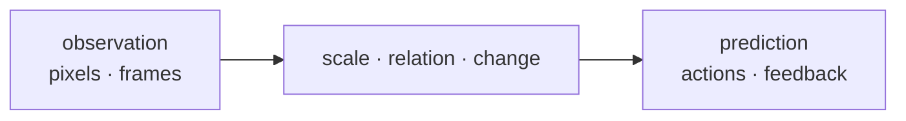

<h1>The Spatial-Free World Model</h1>

<em>Why doesn't artificial intelligence need to understand space?</em>

  

English · <a href="README.zh-CN.md">中文</a>

  

 

---

We have always taught AI to understand the world the way humans do.

We tell it what distance is, what position is, what front and back mean, what three-dimensional space is.

But we have overlooked one question:

<strong>Can AI actually feel space?</strong>

Even if we give a robot a body — let it walk, turn, and touch objects — it remains a brain in a vat, one that merely happens to be able to act.

What it comes into contact with is always information delivered by sensors, never the physical world as humans understand it.

<em>Are distance, position, and depth the essence of the world — 
or an explanatory framework that humans built in order to understand the world?</em>

For a model, what it actually receives are images, pixels, changes of scale, and the differences in information between consecutive observations.

A distant car gradually grows larger; a nearby pedestrian gradually shrinks. The world presents different information at different scales.

So why must these changes be translated back into 3D coordinates?

Why not learn scale, relations, and change directly?

---

### The core idea

> Do not reconstruct three-dimensional space. Do not fixate on absolute distance. Do not force the model to understand positions defined by humans.
>
> Learn the world directly from observations. Learn regularities from changes of scale. Predict the future from actions and feedback.

No coordinates in between. Only what actually varies between observations.

### Two ways of understanding

| | Reconstructive world model | Spatial-free world model |
| :-- | :-- | :-- |
| Assumes | 3D space is the world | observations are the world |
| Learns | coordinates, depth, pose | scale, relation, change |
| Unit | meters | differences in information |
| Goal | rebuild the scene | predict the next observation |

---

We are not trying to make AI understand the world the way humans do.

We are looking for a way of understanding information that suits AI itself.

<em>Space may be the language of humans — 
but not necessarily the language in which AI understands the world.</em>

 

<a href="README.zh-CN.md">中文</a> · English

